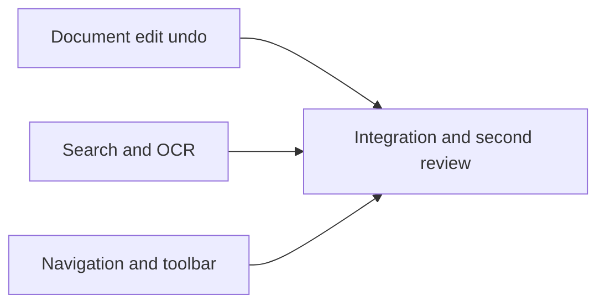

# Editor usability improvements

User approved the seven recommendations in the preceding review and requested implementation followed by a thorough second review. AI orchestration remains active. Preserve all existing dirty migration work; do not commit, reset, stash, push or publish.

## Design and constraints

Keep Electron, Solid and existing IPC/mutation queues. No new runtime dependencies. Implement undo for structural edits without losing annotation history; keep PDF data in the backend and bound retained history memory. Saves preserve editable annotations; exports include visible annotations. Explain those outcomes in the UI. Add direct page/zoom entry and persistent fit modes, searchable-location highlights and first-result navigation, current-page/default OCR plus whole-document option and stop, contextual stable toolbar controls, platform shortcut labels, visible actionable failures. Preserve prior floating motion, reduced-motion behavior, plain OCR copying and safe paste.

Ruling: use three disjoint implementation packages with direct coordination, following the existing migration workflow; a generated skeleton and task commits would disturb a heavily dirty checkout. Contracts are verified through real integration tests and native Electron probes. Accept larger package size to preserve module ownership. No separate approval is required because the user explicitly approved these changes.

%% taskgraph
% T1 --> T4
% T2 --> T4
% T3 --> T4

## T1 Document history

Owns: electron/pdf-service.ts, electron/pdf-types.ts, electron/protocol.ts, src/platform/desktop.ts, src/state/document.ts, src/annotations/store.ts, src/viewer/pageClipboard.ts, src/viewer/pageRotation.ts, src/viewer/documentHistory.ts (new), any additional narrowly scoped history module, tests/pdf-service.test.ts, tests/renderer-state.test.ts, tests/document-history.test.ts (new).

Contract: export undoDocumentEdit(): Promise<void>, redoDocumentEdit(): Promise<void>, canUndoDocumentEdit(): boolean, canRedoDocumentEdit(): boolean from src/viewer/documentHistory.ts. The functions route annotation and structural edits in user action order and remain reactive for toolbar availability. Existing undoAnnotations/redoAnnotations remain usable for annotation-only operations. Restore PDF page bytes/layout, annotations, annotation histories and page selection/current page after delete/duplicate/paste/cut/rotation. New edits invalidate redo; undo after save remains a dirty change. Backend restores increment revision, reject stale requests and release retained memory on close. Retained snapshots have a conservative memory/count bound. Use existing mutation queues; never recursively enqueue an already queued operation. Page action failures use existing emitToast.

Review focus: delete annotated page then undo restores its editable text; prior annotation undo remains available across structural boundaries; redo restores page deletion; rotate undo restores annotation geometry; new annotation edit after undo invalidates structural redo; save-undo doesn't falsely report clean; failed/stale edit does not consume history; independent tabs and close cleanup; bounded backend history. Focused behavior tests before code.

## T2 Search and OCR

Owns: src/platform/pdf-engine.ts, src/search/**, src/ocr/ocr.ts, src/ocr/OcrButton.tsx, src/ocr/TextLayer.tsx, src/ocr/textLayer.css, src/ipc/pdf.ts, tests/pdf-engine.test.ts, tests/ocr.test.ts, tests/search.test.ts (new).

Contract: preserve existing public APIs used by T1/T3; extend SearchHit with optional normalized rectangles and coordinate-space information as needed. Search panel manages its own active match store; TextLayer renders a noninteractive highlight and scrolls the active rectangle into view after page navigation. Preserve text selection/copy and correct intrinsic-rotation/OCR spaces. First Enter navigates first hit; subsequent Enter/ShiftEnter traverse results. Search result selection and highlighting invalidate on tab/revision/query changes. OCR default click runs current page; small menu offers whole document; running state exposes stop. Existing cancelOcr stops further scheduling, clears busy, discards late publication, and keeps completed results; explain that an in-flight recognition may finish. Display per-page failures in UI, allow retry. Replace save alert errors with existing toast and retain transactional save semantics.

Review focus: multiple matches/lines, Unicode, native vs OCR coordinate spaces, rotated page, no stale highlights on document edit/tab switch, first Enter selects first result, cancelled OCR schedules no next page, complete count and retry after failure. Preserve backward runOcrAll and stale-revision protections.

## T3 Navigation, toolbar and feedback

Owns: src/toolbar/**, src/keyboard.ts, src/viewer/PdfViewer.tsx, src/viewer/PageCanvas.tsx, src/viewer/Thumbnails.tsx, src/viewer/imageDrop.ts, src/viewer/viewer.css, src/viewer/navigation.ts (new), src/annotations/AnnotationToolbar.tsx, src/annotations/annotations.css, src/annotations/TextFormatToolbar.tsx (only shortcut labels if needed), src/tabs/TabStrip.tsx, src/images/ImageImportDialog.tsx (save wording only), src/styles/global.css, src/platform/shortcuts.ts (new), tests/navigation.test.ts (new), tests/toolbar.test.ts (new).

Contract: import T1 undoDocumentEdit/redoDocumentEdit/canUndoDocumentEdit/canRedoDocumentEdit for toolbar and global keyboard; assume these exports exist while T1 builds. Keep zoom mode in a small independent navigation module, avoiding changes to src/state/document.ts. Page number accepts validated integer (clamp valid out-of-range; reject empty/invalid), zoom accepts percentage within supported range, fit-width and fit-page track viewer resizing/sidebar/page geometry. Manual zoom clears fit mode. Visible search button. Save button label/tooltips consistently mean Save, explicit accessible Save As control/menu; export label means annotation-inclusive PDF. Save status distinguishes editable state from PDF export. Contextual color/stroke/fill settings with stable toolbar area and no floating-menu layout shift; preserve textColor behavior and floating motion. Platform-aware modifier labels throughout touched toolbar/tab UI; tool hotkeys where no conflict, guard native form controls. Visible render failure with retry, thumbnail failure retry, copy/image failure toast; no repeated toast flood from render loops. Image-import help correctly describes save/export. No new dependencies.

Review focus: page/zoom validation, fit resize/rotation, page navigation while current page changes from scrolling, zoom clears fit, keyboard editable/interactive guard, Mac/Windows labels, search discovery, narrow viewport toolbar overflow, render retry stale request rejection, previous text editor paste/motion intact.

## T4 Integration and second review

Coordinator verifies ownership, build and full tests after last source edit. Run native Electron probes for the integrated workflows, narrow/wide layouts, fit and search positions, text paste and motion regression. Package Mac arm64 and run packaged smoke. A fresh final reviewer reads a packet containing relevant diff excerpts, contracts and test evidence. Then inspect open/save/export, undo, search/OCR, image import, keyboard/accessibility, performance/lifecycle for remaining improvements; report concrete observed gaps with priorities, separate from completed work. Windows native runtime cannot be exercised on this Mac; state that limitation accurately. No commits or outward actions.
