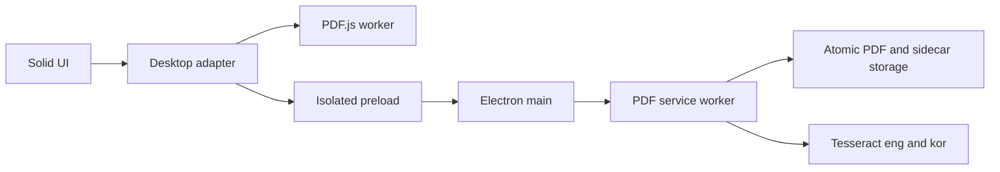
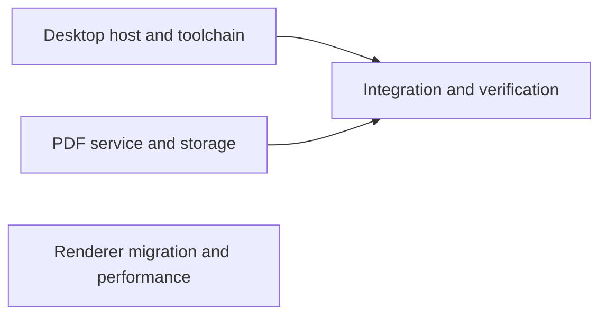

# Electron migration

**Goal:** Replace the active Rust/Tauri desktop application with Electron for Windows and macOS; preserve all PDF viewing, annotations, page edits, OCR, capture and image-to-PDF features while fixing the audited performance and async correctness problems.
**Architecture:** Solid renderer with PDF.js; isolated Electron preload; PDF service in a Node worker using pdf-lib, fontkit and Tesseract.js. No native addons or platform OCR scripts.
**Tech stack:** TypeScript, Solid, Vite, Electron, electron-builder, PDF.js, pdf-lib, Tesseract.js.
**Spec path:** docs/plans/2026-10-21-electron-migration.md
**Detail:** contracts
**Target-min:** 40

## 1. Global constraints and authorized design
- User approved Electron migration and previous audit fixes. Preserve existing uncommitted image import work. Do not commit, stash or discard user changes. Keep legacy src-tauri source outside active build for reference; remove Tauri from active imports, dependencies, scripts and CI.
- Existing src/ipc/pdf.ts command names, camelCase argument and payload shapes are authoritative except renderer rendering/text/search commands are intercepted locally by src/platform/desktop.ts. Other renderer modules import this desktop adapter instead of Tauri. Preserve ArrayBuffer RGBA width/height BE prefix rendering API and OcrLine shape from src/ocr/ocr.ts.
- Adapter exports invoke<T>(command,args?), open(options), save(options), ask(message,options), confirmUnsaved(message): Promise<'save'|'discard'|'cancel'>, readFile(path), writeFile(path,bytes), listen<T>(name,handler): Promise<()=>void>, onFileDrop(handler): ()=>void, filePath(file): string. Event handlers receive {payload:T}; drop payload paths + position in CSS client pixels. Preload exposes window.desktop with narrow command/event allowlists, dialogs and file access; no Electron objects or generic IPC exposed.
- Backend new command pdf_document_bytes({docId,expectedRevision}) -> Uint8Array. Renderer bridge handles pdf_render_page, pdf_capture_region, pdf_text_lines, pdf_search. Backend pdf_ocr_page accepts additionally image:Uint8Array rendered PNG and imageWidth/imageHeight, returns existing {text,lines}; lines normalized as existing backend. Backend owns pdf_ocr_lines/status/flush. OCR batches flush once on completion/cancel, and close/save flushes too. OCR models eng+kor bundled for offline operation.
- Backend exports PdfService constructor({dataDir:string, legacyDataDirs?:string[], assetsDir?:string}) and invoke(command:string,args:Record<string,unknown>):Promise<unknown>, dispose():Promise<void>. Electron worker serializes calls; service protects revision and external file edits, validates inputs, uses atomic replacement. Page clipboard holds only one snapshot/token. Annotation storage preserves v2 exact, legacy, recovered, ambiguous and mismatch behavior and fingerprint/copy ownership safety. Existing annotations are not flattened by normal Save; export does flatten.
- Bundled licensed CJK font for export; measured TextLayoutLine fragments are the only rich text contract, no HTML parser/manual cmap code. Preserve page/annotation rotations. SVG images normalize once before export. Avoid JSON stringify in reactive dependencies, use monotonic annotation editVersion and one shared save flow. Async drops target captured tab and reject stale documents.
- Electron Node build prerequisites may require Node >=22.12; current system Node is 20.20.0, use npx node@22 as needed and document requirement. Package for Mac arm64/x64 and Windows x64/arm64, standard native recent documents, single instance OS-open queue, subscribe before draining initial paths. No private Dock APIs.
- Security: sandbox+contextIsolation, Node disabled in renderer, local app only, reject navigation/window creation, validate sender and commands, no remote assets. All long work off main thread. No signing credentials; unsigned local packaging only.
- Tests use node:test/tsx. Fast command: npm test. Build: npm run build. Packaged app smoke and platform CI validate integration. Do not claim Windows native runtime validation on Mac.

## 2. Data flow

## 3. File structure and task graph
- electron/main.ts, preload.ts, worker.ts: desktop lifecycle, constrained IPC and service execution.
- electron/pdf-service.ts, annotation-store.ts, export.ts, ocr.ts: PDF state, compatibility storage, flattened export, OCR.
- src/platform/desktop.ts and pdf-engine.ts: typed desktop adapter and renderer PDF.js cache.
- Existing src modules: preserve UI and fix lazy work, tab identity, scrolling and save concurrency.
- scripts, configs, CI, README: active Electron development and distributables.

```mermaid
%% schedule
gantt
  title Predicted schedule (mm:ss)
  dateFormat X
  axisFormat %M:%S
  section lane 1
  T2 PDF service and storage :t2, 0, 396s
  T4 Integration and verification :t4, 396, 145s
  section lane 2
  T3 Renderer migration and performance :t3, 0, 370s
  section lane 3
  T1 Desktop host and toolchain :t1, 0, 357s
```

critical path: T2 → T4 (9.0 min) · peak width 3 · predicted build 9.0 min · predicted total ≈ 12.5 min (target ✓)

## Desktop package
**Probe entry:** run=npm run build

### T1 Desktop host and toolchain · Complexity 7 · Est. context 55k
**Owns:** electron/main.ts, electron/preload.ts, electron/worker.ts, electron/worker-client.ts, electron/protocol.ts, src/platform/desktop.ts, src/platform/pdf-engine.ts, src/platform/global.d.ts, package.json, package-lock.json, vite.config.ts, tsconfig.electron.json, electron-builder.yml, scripts/dev.mjs, scripts/build-electron.mjs, scripts/prepare-assets.mjs, scripts/smoke-electron.mjs, .github/workflows, README.md, .gitignore, tests/desktop.test.ts, tests/pdf-engine.test.ts
**Components:** 3
**LOC owned:** 1400
**Tests:** slow
**Model:** sonnet
**Est. time:** 6 min
**Consumes:** PdfService.invoke(command:string,args:Record<string,unknown>)->Promise<unknown> (T2)
**Produces:** desktop.invoke(command:string,args:Record<string,unknown>)->Promise<unknown>
 e.g. desktop.invoke('initial_open_paths',{}) -> []
 e.g. desktop.invoke('pdf_ocr_status',{docId:'a',expectedRevision:0}) -> [0]
**Review Focus:** protocol/security unknown command and foreign sender rejected; file open event queued before renderer subscription; renderer revision cache invalidates after edit; bounded render allocation; shutdown disposes workers; packaging resources offline.
**Test code:** test_unknown_command_rejected -> invoke('exec',{}) rejects; test_revision_cache -> revision 1 never returns revision 0 bytes; test_closed_document -> pending stale render rejected.
**Steps:** Write focused failing cases; implement host and adapter; install dependencies with npm only; run focused tests then build. Coordinate exact files/types with T2/T3. No service implementation. Ensure PDF.js cMaps/fonts/worker and OCR models/font packaged.

## PDF package
**Probe entry:** call=PdfService.invoke

### T2 PDF service and storage · Complexity 9 · Est. context 70k
**Owns:** electron/pdf-service.ts, electron/annotation-store.ts, electron/storage.ts, electron/export.ts, electron/ocr.ts, electron/pdf-types.ts, tests/pdf-service.test.ts, tests/annotation-store.test.ts, tests/pdf-export.test.ts, tests/ocr.test.ts, resources/fonts
**Components:** 3
**LOC owned:** 1700
**Tests:** slow
**Model:** sonnet
**Est. time:** 6 min
**Consumes:** none
**Produces:** PdfService.invoke(command:string,args:Record<string,unknown>)->Promise<unknown>
 e.g. PdfService.invoke('pdf_ocr_status',{docId:'a',expectedRevision:0}) -> [0]
 e.g. PdfService.invoke('pdf_document_bytes',{docId:'a',expectedRevision:0}) -> Uint8Array([37,80,68,70])
**Review Focus:** file atomic save and external-change guard; state stale revision rejection; encoding Korean rich text export and rotated pages; identical copies never share annotations; migrated legacy moved files recover; deleting all pages rejected; single clipboard survives source close; image import preserves order; OCR stale results rejected and valid empty result distinct from malformed data.
**Test code:** test_stale_revision -> revision 0 after rotation rejects; test_copy_ownership -> identical bytes at existing distinct paths do not attach same sidecar; test_external_edit -> save original path after outside modification rejects and leaves bytes; test_pages -> duplicate/delete/paste rotation maps indices; test_image_pdf -> two PNGs yield two A4 pages; test_export -> Korean layout and 90-degree page export reloads with pdf-lib.
**Steps:** Read existing Rust behavior and port required contracts using pdf-lib/fontkit/Tesseract; focused failing tests then implementation; download licensed CJK font and license if needed, tell T1 resource location; no package manifest edits. Keep API simple, eliminate duplicated parsing and per-page OCR disk writes.

## Renderer package
**Probe entry:** run=npm test

### T3 Renderer migration and performance · Complexity 8 · Est. context 65k
**Owns:** src excluding src/platform, tests/image-pdf.test.ts, tests/annotations.test.ts, tests/renderer-state.test.ts, tests/autosave.test.ts
**Components:** 3
**LOC owned:** 1500
**Tests:** slow
**Model:** sonnet
**Est. time:** 6 min
**Consumes:** desktop.invoke(command:string,args:Record<string,unknown>)->Promise<unknown> (T1)
**Produces:** renderer.ready()->boolean
 e.g. renderer.ready() -> true
**Review Focus:** state image drop targets original tab during await; scroll does not snap and tab scroll restores; only nearby pages mount expensive layers; OCR completion affects only corresponding page; save snapshot version cannot clear a newer edit; opening listener exists before startup queue drains; cancel close preserves window.
**Test code:** test_drop_tab_switch -> annotation added only to original tab; test_save_race -> editing while save is pending keeps dirty=true; test_image_pdf -> existing image import tests all pass with desktop mock; test_autosave -> version dependency replaces whole JSON traversal.
**Steps:** Preserve existing UI and user edits; replace Tauri imports with desktop adapter, migrate opening/close guard/drop; add editVersion to all annotation mutations and share autosave/manual save; remove eager all-page prefetch, unmount offscreen expensive work and bound bitmap memory; page-specific OCR dependency and batch flush; fix navigation versus scroll tracking and tab restoration. Run focused tests. Do not edit src/platform or manifests.

## Integration
**Probe entry:** run=npm run build

### T4 Integration and verification · Complexity 5 · Est. context 25k
**Owns:** reports/electron-migration.md, tests/electron-integration.test.ts
**Components:** 1
**LOC owned:** 150
**Tests:** slow
**Model:** sonnet
**Est. time:** 3 min
**Consumes:** renderer.ready()->boolean (T3)
**Produces:** migration.verified()->boolean
 e.g. migration.verified() -> true
**Review Focus:** built preload works in sandbox, full PDF open/render/edit/export/image/OCR/save lifecycle, no Tauri runtime, platform build matrix.
**Test code:** test_lifecycle -> open fixture, revision bytes, page rotation, save and reload same page count; smoke actual Electron opens generated PDF without renderer errors.
**Steps:** Run full tests/build and app smoke; route fixes to owner; build unsigned Mac directory and cross Windows archive if tooling permits; record actual measurements and platform limits. Fresh final review before completion.

## Review Focus and self-review
File generator: file/encoding/deep; UI: protocol/encoding/state; concurrency: state/protocol. Coverage maps to T1-T4. Ownership is disjoint, examples permit independent starts, execution edges only join at integration. No commits or branch switching in dirty checkout. User authorization supersedes extra approval prompts.
