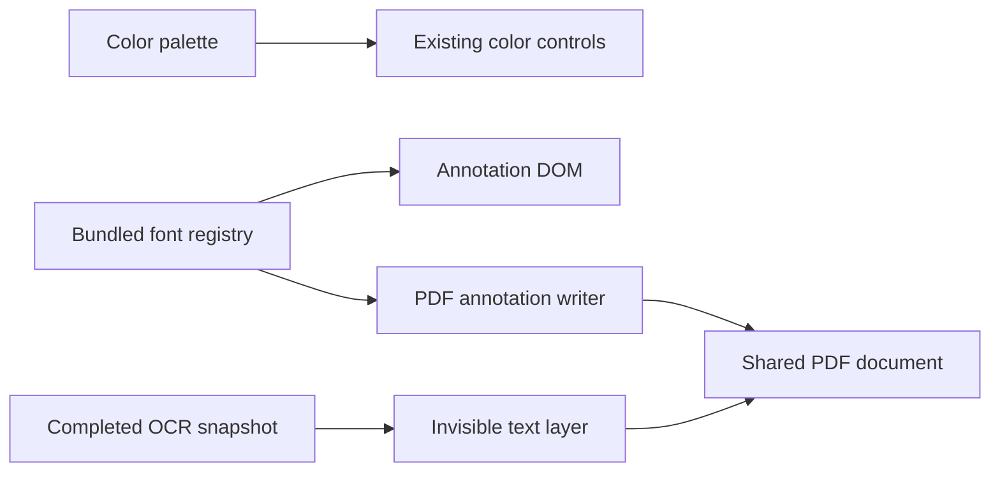
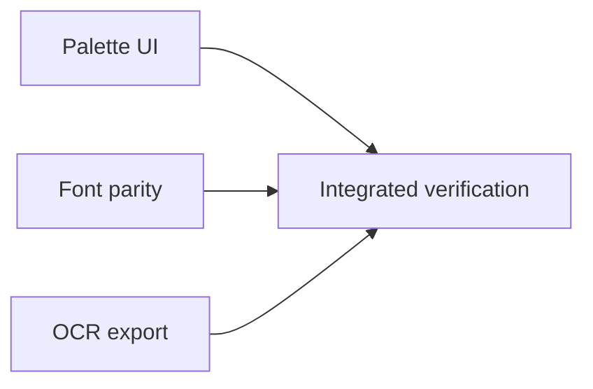

# Color palette and PDF output fidelity

**Goal:** Excel-style theme/tint/standard color palette; screen/export font parity; OCR-searchable exported PDF.
**Architecture:** Shared Solid color popover, bundled font registry used by renderer/PDF writer, hidden OCR text added to the same PDF document at export.
**Tech stack:** Existing Solid, Electron, pdf-lib/fontkit, PDF.js; no new runtime dependencies.
**Detail:** contracts
**Target-min:** 18
**Spec:** Latest user screenshot and request plus high-priority items 1–2 in reports/editor-usability-review.md.

## Global constraints

Preserve the restored inline header composition, floating menu motion/reduced motion, black text/paste defaults, active editor selection, undo and stale-revision safeguards. macOS/Windows must use bundled fonts offline. Never reset/stash/commit/push this dirty migration checkout. AI orchestration and direct disjoint ownership continue from the previous authorized task; no generated skeleton overwrites or task commits. New assets must include original license/source. Keep the implementation small.

Ruling: two bundled Korean-capable families (Noto Sans KR and Noto Serif KR), Regular/Bold, supply predictable screen/export typography. Legacy family names map to a supported family, with the toolbar explaining bundled replacement. Italics use the same synthetic shear on screen/export; do not regress complete TrueType embedding needed for CJK outlines.
Ruling: the existing PDF export includes completed OCR results automatically, without another header button or automatic recognition. The export help explains this. Save keeps editable sidecars. Partial OCR includes completed pages only. Existing native PDF text remains unchanged; avoid exact OCR/native duplicate text where practical without a new OCR engine.
Ruling: use direct disjoint skill implementers as in the previous task. The dirty tree predates HEAD; broad generated commits/diffs would obscure this task. Contracts, focused tests, real Electron checks and fresh final review verify the seams.

## T1 Palette · Complexity 5 · Est. context 32k

**Owns:** src/annotations/ColorPalette.tsx (new), src/annotations/colorPalette.ts (new if useful), src/annotations/colorPalette.css (new), src/annotations/AnnotationToolbar.tsx, src/annotations/TextFormatToolbar.tsx, src/annotations/annotations.css (only remove obsolete color styles), tests/color-palette.test.ts (new).
**Components:** 2
**LOC owned:** 270
**Tests:** fast
**Model:** sonnet
**Produces:** ColorPalette(props: {value: string; onChange: (color: string) => void; label: string; disabled?: boolean}) -> JSX.Element
**Consumes:** Existing annotation color setters and text format actions; unchanged by peers.
**Contract:** Single compact swatch trigger opens an anchored floating palette with ten theme columns, five tint/shade rows and ten standard colors, plus custom color picker. White/black/theme/standard choices match reference. Checked/current color indicator; Korean labels and HEX titles; keyboard arrows/Home/End/Enter/Escape, tab-friendly dismissal; no header layout shift. Clamp popup to viewport, portal outside clipping/inert ancestors as appropriate. Preserve active text range and editing on pointer and keyboard color selection/custom input. Close on outside click/tab/document/context change; no listener leaks or orphan portal when floating parent closes. Replace drawing, fill and floating text color inputs consistently. Do not change font select code or header arrangement. Update export tooltip to explain completed OCR inclusion without adding controls.
**Review Focus:** Current/custom color, all swatches valid, keyboard row boundaries, Escape closes only palette and restores trigger, selection formatting vs whole annotation, popup bounds 720/1280, no body overflow, reduced motion.
**Probe entry:** call=src/annotations/colorPalette.ts
**Steps:** meaningful failing behavior tests first; implement; focused tests and self-review.

## T2 Fonts · Complexity 6 · Est. context 42k

**Owns:** src/annotations/fonts.ts (new shared renderer/backend registry), src/annotations/fonts.css (new), src/annotations/textFormat.ts, src/annotations/AnnotationLayer.tsx, src/annotations/sanitize.ts, src/annotations/persistence.ts, src/state/document.ts (font default only), src/styles/global.css (font CSS import only), electron/export.ts, scripts/prepare-assets.mjs (font web asset preparation only), resources/fonts/**, tests/font-parity.test.ts (new), tests/pdf-export.test.ts, tests/annotations.test.ts (only font normalization expectations).
**Components:** 3
**LOC owned:** 250
**Tests:** slow
**Model:** sonnet
**Produces:** flattenPdf(bytes: Uint8Array, input: unknown, assetsDir?: string, ocrPages?: ReadonlyMap<number, OcrPage>) -> Promise<Uint8Array>
**Consumes:** addOcrTextLayer(pdf: PDFDocument, pages: ReadonlyMap<number, OcrPage>, getFont: () => Promise<PDFFont>) -> Promise<void> from electron/ocr-export.ts (T3). Call after annotation drawing and before pdf.save, only when OCR nonempty. getFont returns shared embedded Noto Sans KR Regular.
**Contract:** Offer Noto Sans KR/Noto Serif KR via existing COMMON_FONTS export. Fetch official Noto Serif KR TrueType source and generate static400/700 with FontTools like current Sans; license/documentation included. Renderer and PDF embed exactly same faces, including Korean/Latin/bold and stable metrics. Normalize legacy and inline fonts consistently across sanitize/render/measurement/export; Serif aliases map Serif, other unsupported names Sans. Keep existing user content/formatting. Wait for fonts before export DOM measurement to avoid fallback metrics. Reuse embedded fonts per family+weight. Synthetic italic must match existing horizontal shear, no incorrect vertical skew. Complete TTF embedding for CJK. T1 owns TextFormatToolbar: send coordinator any tiny font-label/help patch rather than editing it. Coordinate use of shared OCR helper contract; T3 owns module.
**Review Focus:** Serif and Sans distinctly embedded, Korean glyph ink intact, bold and italic, legacy/inline fallback normalization, fonts loaded before layout, mixed fragments and spaces, no-font fallback uses annotation style, screen/font export widths consistent.
**Probe entry:** call=electron/export.ts:flattenPdf
**Steps:** red font-selection/export tests first; implement; focused tests and self-review.

## T3 Searchable OCR export · Complexity 6 · Est. context 35k

**Owns:** electron/ocr-export.ts (new), electron/pdf-service.ts (export path only), tests/ocr-export.test.ts (new), tests/pdf-service.test.ts (export-specific tests only).
**Components:** 2
**LOC owned:** 220
**Tests:** slow
**Model:** sonnet
**Produces:** addOcrTextLayer(pdf: PDFDocument, pages: ReadonlyMap<number, OcrPage>, getFont: () => Promise<PDFFont>) -> Promise<void>
**Consumes:** flattenPdf(bytes: Uint8Array, input: unknown, assetsDir?: string, ocrPages?: ReadonlyMap<number, OcrPage>) -> Promise<Uint8Array> from T2. Optional fourth argument must not change existing exports.
**Contract:** For completed OCR snapshot only, embed invisible selectable/searchable text at normalized OCR line bounds. Use actual text rendering mode Invisible (3), preserving visible PDF pixels. Coordinates are normalized in PDF.js intrinsic-rotation display space; map crop origins and rotations0/90/180/270, proportional horizontal fitting, no transient viewer rotation. Preserve Unicode/Korean spaces/linebreaks meaningfully. Reject invalid geometries rather than corrupt output; ignore empty/zero-area lines. Snapshot OCR map at export invocation; no OCR sidecar is needed to search exported PDF. Keep original text/content and avoid exact duplicate OCR text on native-text pages where reasonable. Service writes atomically and keeps current PDF path/bytes/revision/dirty state. No save path change. Do not edit electron/export.ts: T2 owns integration call.
**Review Focus:** PDF.js text extraction finds Korean+Latin on formerly image-only PDF; render pixel equality before/after; display bounds on cropped rotated pages; empty/partial cache; no duplicate existing text; service forwards snapshot and doesn't mutate source.
**Probe entry:** call=electron/ocr-export.ts:addOcrTextLayer
**Steps:** failing export tests first, then implementation; focused tests and self-review. Test helper directly while T2 integration is pending; integration tests after T2 exists.

## T4 Integrated verification

Coordinator validates seams, all tests/build/diff check, actual Electron palette selection and keyboard/viewport/editor-range behavior, font rendering/export measurement, OCR extraction and pixel identity. Rebuild Mac arm64 app and packaged smoke. Fresh packet-only reviewer after source freeze. Update reports with actual measured results and remaining medium-priority items. Windows native runtime remains untested on Mac.

## Execution rulings

T2 ownership also includes src/ipc/pdf.ts (await fonts before measuring only) and src/annotations/textLayout.ts (font normalization). T1 may prepare ignored .superlite/palette-probe.cjs for coordinator execution. Exact native/OCR duplicate suppression is deferred: pdf-lib does not extract text, and another PDF parser in the host is outside this simple implementation. Native content is preserved.

## Completion — 2026-10-22

T1/T2/T3 implemented; T4 complete after final native and packaging checks. Final full suite 82 passed / 0 failed / 0 skipped (5.6s); renderer/Electron TypeScript and production build pass (Vite 3.32s). Real Electron confirms 70swatches, selected text retained for mouse/keyboard/custom colors, local Escape, Tab to custom/Shift+Tab back/Tab out dismissal, viewport bounds720/1280, all4fontfaces loaded and DOM/PDF widths within0.01px. Existing floating motion/reduced motion regression remains green. OCR PDF.js extraction/rotated crop geometry/pixel identity/source snapshot checks green.

Fresh packet-only final review found one issue: unconditional Tab dismissal blocked custom input keyboard access. Resolved by removing that interception and verified by real Electron Tab/Shift+Tab/Tab-out reproduction; no extra abstraction. Explicit Enter/Space swatch activation has DOM keyboard regression and native proof. No unresolved source findings. Earlier development red tests and harness-only arrow/eval issues are superseded by final green suite/probe; production CSP unchanged.

Ruling: preserve existing dirty main checkout and leave changes uncommitted, continuing established session workflow. Existing native/OCR duplicate suppression remains deferred; full embedded CJK fonts add output/assets size; legacy fonts use bundled replacements; Windows native execution remains untested. Detailed report: reports/palette-pdf-export-review.md.

Final Macarm64 package and packaged offline OCR/render/save/export smoke passed after the Tab fix. Detailed completion evidence is in reports/palette-pdf-export-review.md.
