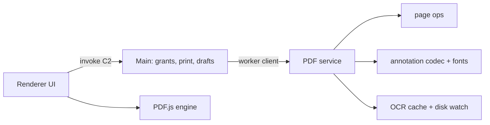
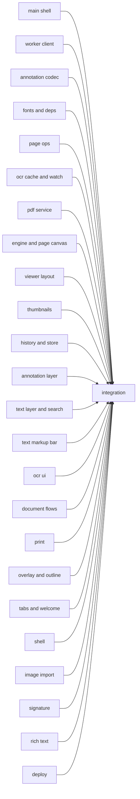

# RustyPDF overhaul

**Goal:** Fix every review item in §1 and §2 and ship every §3 feature.
**Architecture:** Electron main (grants, print host), worker (PDF service, page ops, annotation codec, OCR cache), Solid renderer (PDF.js engine, viewer, annotations, flows).
**Tech stack:** TypeScript, Solid, Electron 45, pdf-lib, PDF.js 6.4, tesseract.js; one new dependency: subset-font.
**Spec:** docs/plans/2026-10-23-overhaul.spec.md (Decisions, Shared contracts C1–C8, §1–§3).
**Detail:** contracts
**Target-min:** 30
**Ignore:** dist/, dist-electron/, release/, resources/assets/, public/pdfjs/, public/fonts/

## Global constraints

```mermaid
%% schedule
gantt
  title Predicted schedule (mm:ss)
  dateFormat X
  axisFormat %M:%S
  section lane 1
  T1 main shell :t1, 0, 266s
  T17 print :t17, 266, 134s
  T25 integration :t25, 472, 145s
  section lane 2
  T3 annotation codec :t3, 0, 259s
  T24 deploy :t24, 259, 140s
  section lane 3
  T7 pdf service :t7, 0, 247s
  T15 ocr ui :t15, 247, 147s
  section lane 4
  T5 page ops :t5, 0, 229s
  T9 viewer layout :t9, 229, 147s
  section lane 5
  T16 document flows :t16, 0, 210s
  T6 ocr cache and watch :t6, 210, 147s
  T23 rich text :t23, 357, 115s
  section lane 6
  T10 thumbnails :t10, 0, 201s
  T22 signature :t22, 201, 153s
  T21 image import :t21, 353, 118s
  section lane 7
  T13 text layer and search :t13, 0, 197s
  T8 engine and page canvas :t8, 197, 163s
  T14 text markup bar :t14, 360, 113s
  section lane 8
  T11 history and store :t11, 0, 193s
  T4 fonts and deps :t4, 193, 168s
  T2 worker client :t2, 361, 110s
  section lane 9
  T20 shell :t20, 0, 190s
  T19 tabs and welcome :t19, 190, 185s
  section lane 10
  T12 annotation layer :t12, 0, 187s
  T18 overlay and outline :t18, 187, 187s
```

Read the spec's Decisions, Shared contracts and your § items first; names and payloads there are binding. Tests: `node --import tsx --test <files>` (tsx IPC is blocked in the sandbox; never `npx tsx --test`). Export `SUPERLITE_PYTHON=~/.local/share/uv/python/cpython-3.13.11-macos-aarch64-none/bin/python3` before any `sl` call. npm needs `--cache "$TMPDIR/npmcache"`. Edit only your Owns; reference peers by the contract names even if their code is not there yet, and test against small fakes. Korean UI strings. Do not commit, push or change git state. Wave 0 creates only missing NEW files as stubs and never edits existing files.

critical path: T1 → T25 (6.9 min) · peak width 10 · predicted build 10.3 min · predicted total ≈ 13.8 min (target ✓)

## Electron

### T1 main shell · Complexity 6 · Est. context 50k
**Owns:** electron/main.ts, electron/smoke.ts, electron/grants.ts, electron/protocol.ts, electron/preload.ts, index.html, scripts/smoke-electron.mjs, tests/main-grants.test.ts
**Features:** components=4, loc=520, tests=slow, model=sonnet
**Consumes:** initAutoUpdates() -> void (T24)
**Produces:** PathGrants.checkCommand(command: string, args: Record<string, unknown>) -> Record<string, unknown>
- e.g. checkCommand("pdf_save_document", {targetPath: "/x.pdf"}) -> {targetPath: "/x.pdf", requireCurrentPath: true}
**Contract:** C2 command list and events, C3 grants and image conversion, print_images, open_external, paths_exist, draft_* (userData/drafts, sha256 of path), `fontsDir` in workerData (§2.20), §1.7 recents, §1.8, §2.16, §2.17, §2.19 menus. Uses `PdfWorkerClient` from T2.
**Review Focus:** ungranted desktop:write rejected; open_external rejects file: and javascript:; draft path hashing; smoke still green.

### T2 worker client · Complexity 4 · Est. context 26k
**Owns:** electron/worker-client.ts, electron/worker.ts, tests/desktop.test.ts
**Features:** components=1, loc=160, tests=fast, model=sonnet
**Produces:** PdfWorkerClient.invoke(command: string, args: Record<string, unknown>) -> Promise<unknown>
- e.g. invoke("pdf_ocr_status", {docId: "a", expectedRevision: 0}) -> [0, 2]
**Contract:** §1.5, §2.17. Constructor `(path, workerData, hooks: {onEvent?(name, payload), onRestart?(error)})`; respawn after an unexpected exit (max 3 per minute), reject pending with "PDF 엔진이 중단되었습니다"; worker forwards service events as `{event, payload}`.
**Review Focus:** crash during invoke rejects then the next invoke works; dispose never respawns.

### T3 annotation codec · Complexity 7 · Est. context 55k
**Owns:** electron/pdf-annotations.ts, electron/export.ts, electron/ocr-export.ts, tests/pdf-annotations.test.ts, tests/pdf-export.test.ts, tests/ocr-export.test.ts, tests/font-parity.test.ts
**Features:** components=3, loc=650, tests=slow, model=sonnet
**Consumes:** subsetFontBytes(bytes: Uint8Array, text: string) -> Promise<Uint8Array> (T4)
**Produces:** writeAnnotations(pdf: PDFDocument, data: AnnotationSidecar, fontsDir?: string) -> Promise<void> · readAnnotations(pdf: PDFDocument) -> Annotation[] · stripAnnotations(pdf: PDFDocument) -> number · flattenPdf(bytes: Uint8Array, input: unknown, fontsDir?: string, ocrPages?: ReadonlyMap<number, OcrPage>) -> Promise<Uint8Array> · addOcrTextLayer(pdf: PDFDocument, pages: ReadonlyMap<number, OcrPage>, fontsDir?: string) -> Promise<void>
- e.g. readAnnotations(pdfWithOneRect) -> [{id: "r1", page: 0, type: "rect", rect: {x: 10, y: 20, w: 30, h: 40}, style: {color: "#ff0000", width: 2}}]
- e.g. stripAnnotations(pdfWithOneRect) -> 1
**Contract:** C8, §1.3, §2.7, §2.20 subset fonts (also uses loadFontBytes from T4), §3.6. Write→read round-trips every kind incl. quads; foreign annotations untouched.
**Review Focus:** rotated and cropped pages; Korean text survives subsetting (PDF.js extracts it); round-trip of html text; exported arrow head filled.

### T4 fonts and deps · Complexity 4 · Est. context 30k
**Owns:** electron/font-subset.ts, package.json, package-lock.json, scripts/prepare-assets.mjs, scripts/build-electron.mjs, tests/font-subset.test.ts
**Features:** components=2, loc=140, tests=slow, model=sonnet
**Produces:** subsetFontBytes(bytes: Uint8Array, text: string) -> Promise<Uint8Array> · loadFontBytes(fileName: string, fontsDir?: string) -> Promise<Uint8Array>
- e.g. subsetFontBytes(notoSansKr, "한글 A") -> TrueType bytes under 200 KB
**Contract:** §2.20: add subset-font 2.9.0; renderer-only deps to devDependencies; fonts only in public/fonts; esbuild externals add subset-font, harfbuzzjs, electron-updater; subset failure returns the input.
**Review Focus:** subset keeps space and .notdef; packaged path resolution.

### T5 page ops · Complexity 5 · Est. context 40k
**Owns:** electron/page-ops.ts, electron/image-pdf.ts, tests/page-ops.test.ts
**Features:** components=3, loc=420, tests=slow, model=sonnet
**Produces:** applyPageEdit(bytes: Uint8Array, op: PageEdit) -> Promise<PageEditResult> · extractPages(bytes: Uint8Array, indices: number[]) -> Promise<Uint8Array> · mergePdfFiles(paths: string[]) -> Promise<Uint8Array> · createPdfFromImages(paths: string[]) -> Promise<Uint8Array>
- e.g. applyPageEdit(threePages, {kind: "move", indices: [2], toIndex: 0}) -> {mapping: [1, 2, 0], rotated: [], pages: [p2, p0, p1]}
- e.g. applyPageEdit(threePages, {kind: "delete", indices: [1]}) -> {mapping: [0, null, 1], rotated: []}
**Contract:** `PageEdit = {kind: "delete" | "duplicate" | "rotate" | "move" | "insert"; indices?; direction?; toIndex?; afterIndex?; sourceBytes?}`; one load per edit (§2.20); EXIF 5/7 fix (§2.5); §3.4, §3.7 merge and extract; Korean errors.
**Review Focus:** move to the end; insert after -1; Orientation 5/7 pixel check.

### T6 ocr cache and watch · Complexity 4 · Est. context 30k
**Owns:** electron/ocr-store.ts, electron/disk-watch.ts, tests/ocr-store.test.ts
**Features:** components=2, loc=260, tests=fast, model=sonnet
**Produces:** OcrCache.load(key: string, pageCount: number, legacyPdfPath?: string) -> Promise<Map<number, OcrPage>> · OcrCache.save(key: string, pages: Map<number, OcrPage>) -> Promise<void> · remapOcr(pages: Map<number, OcrPage>, mapping: (number | null)[], rotated: number[]) -> Map<number, OcrPage> · DiskWatcher.watch(id: string, path: string, fingerprint: string) -> void
- e.g. remapOcr(new Map([[0, a], [1, b]]), [1, 0], []) -> Map {1 => a, 0 => b}
**Contract:** §2.13, §2.14, §3.8 external change (2 s stat polling, unref'd timer, one event per change, `update()` after own saves).
**Review Focus:** save never throws; legacy file read-only; watcher ignores own writes.

### T7 pdf service · Complexity 7 · Est. context 60k
**Owns:** electron/pdf-service.ts, electron/pdf-types.ts, electron/storage.ts, electron/annotation-store.ts, tests/pdf-service.test.ts, tests/electron-integration.test.ts
**Features:** components=3, loc=560, tests=slow, model=sonnet
**Consumes:** applyPageEdit(bytes: Uint8Array, op: PageEdit) -> Promise<PageEditResult> (T5) · readAnnotations(pdf: PDFDocument) -> Annotation[] (T3) · stripAnnotations(pdf: PDFDocument) -> number (T3) · remapOcr(pages: Map<number, OcrPage>, mapping: (number | null)[], rotated: number[]) -> Map<number, OcrPage> (T6)
**Contract:** all C2 worker commands; D1 open/strip/save; §1.2 remove restore transactions; §1.3 read-only legacy loader; §2.3 read-only and signed detection; §2.13 OCR in history; §2.14; §2.19 rename errors; `new PdfService(options, emit?)` emits `document-changed-on-disk`.
**Review Focus:** save then re-open keeps editable annotations; stripped base keeps foreign annotations; encrypted PDF opens read-only; requireCurrentPath enforced.

## Renderer

### T8 engine and page canvas · Complexity 6 · Est. context 40k
**Owns:** src/platform/pdf-engine.ts, src/platform/desktop.ts, src/viewer/PageCanvas.tsx, tests/pdf-engine.test.ts
**Features:** components=2, loc=380, tests=fast, model=sonnet
**Produces:** pdfEngine() -> PdfEngine · PdfEngine.getDocument(docId: string, revision: number) -> Promise<PDFDocumentProxy> · PdfEngine.recognizePage(docId: string, revision: number, pageIndex: number) -> Promise<OcrPagePayload> · PdfEngine.pageHasText(docId: string, revision: number, pageIndex: number) -> Promise<boolean>
- e.g. recognizePage("a", 0, 0) -> {text: "PDF", lines: [{text: "PDF", x: 0.1, y: 0.1, w: 0.2, h: 0.05}]}
**Contract:** C4, C5 props, §1.1, §1.7 duplicates, §2.8 (debounced exact re-render, cancel stale).
**Review Focus:** stale render cancelled; dpr 2 doubles pixels; 16M px bound.

### T9 viewer layout · Complexity 5 · Est. context 32k
**Owns:** src/viewer/PdfViewer.tsx, src/viewer/navigation.ts, src/viewer/viewer.css, src/state/ui.ts, tests/navigation.test.ts
**Features:** components=2, loc=260, tests=fast, model=sonnet
**Produces:** pxPerPt(zoom: number) -> number · zoomIn() -> void · zoomOut() -> void
- e.g. pxPerPt(1) -> 1.3333333333333333
**Contract:** C5, D4, D5, §2.2 (pointer-down in the viewer calls `clearPageSelection()`), §2.8, §2.9, §2.10, §3.2 sidebar tabs mounting `Outline`, §3.8 inversion.
**Review Focus:** mixed page sizes keep fit zoom; pinch anchor; tab scroll restore.

### T10 thumbnails · Complexity 6 · Est. context 45k
**Owns:** src/viewer/Thumbnails.tsx, src/viewer/thumbnails.css, src/viewer/pageClipboard.ts, src/viewer/pageRotation.ts, tests/page-ui.test.ts
**Features:** components=3, loc=480, tests=fast, model=sonnet
**Produces:** clearPageSelection() -> void · rotateSelectedPages(direction: 1 | -1) -> Promise<void>
**Contract:** §2.2, §3.3, §3.4, §3.7 extract/insert, §3.8 thumbnails; uses `addDocumentTab`, history API (C6), `pdfEngine().renderPage`.
**Review Focus:** ⌘C with text selected copies text; delete toast undo; drag to last slot.

### T11 history and store · Complexity 7 · Est. context 45k
**Owns:** src/viewer/documentHistory.ts, src/viewer/documentHistoryState.ts, src/viewer/documentHistoryRecovery.ts, src/ipc/documentMutations.ts, src/annotations/store.ts, src/annotations/types.ts, src/state/document.ts, tests/document-history.test.ts, tests/annotations.test.ts
**Features:** components=3, loc=420, tests=fast, model=sonnet
**Produces:** addAnnotationToTab(tabId: string, annotation: Annotation) -> boolean · historyBusy() -> boolean · registerPreMutationHook(hook: PreMutationHook) -> () => void
**Contract:** C1, C6, §1.2 (delete documentHistoryRecovery.ts), §1.7, §2.6, pasted annotations clamped to the page.
**Review Focus:** undo across page then annotation entries; edits during restore ignored; 80-entry cap.

### T12 annotation layer · Complexity 6 · Est. context 55k
**Owns:** src/annotations/AnnotationLayer.tsx, src/annotations/annotations.css, src/capture/capture.ts, src/viewer/imageDrop.ts, src/images/normalize.ts, tests/annotation-layer.test.ts
**Features:** components=3, loc=380, tests=fast, model=sonnet
**Contract:** §2.1, §2.5, §2.6, §2.7, quads rendering (C1), pen buffer + RDP 0.5pt, `historyBusy` lock, read-only pass-through, D5.
**Review Focus:** capture of a 200x100pt drag is normalized; EXIF 6 JPEG baked upright; arrow colour per annotation.

### T13 text layer and search · Complexity 6 · Est. context 40k
**Owns:** src/ocr/TextLayer.tsx, src/ocr/textLayer.css, src/ocr/copyText.ts, src/search/SearchPanel.tsx, src/search/model.ts, src/search/store.ts, src/search/search.css, tests/search.test.ts
**Features:** components=3, loc=450, tests=fast, model=sonnet
**Contract:** §1.4, §2.12, D5.
**Review Focus:** "대한민국" split over 4 items matches; whitespace-insensitive; active match kept during OCR.

### T14 text markup bar · Complexity 4 · Est. context 26k
**Owns:** src/annotations/TextMarkupToolbar.tsx, src/annotations/textMarkup.ts, tests/text-markup.test.ts
**Features:** components=1, loc=180, tests=fast, model=sonnet
**Contract:** §3.5; client rects → page-point quads per page via the frame's `data-page-index`, merged per line; uses `addAnnotationToTab`.
**Review Focus:** selection across two pages makes two annotations.

### T15 ocr ui · Complexity 4 · Est. context 30k
**Owns:** src/ocr/ocr.ts, src/ocr/OcrButton.tsx, src/ocr/ocr.css, tests/ocr.test.ts
**Features:** components=2, loc=260, tests=fast, model=sonnet
**Produces:** includeOcrOnSave() -> boolean
**Contract:** §2.13 refresh, §3.11; recognize through `pdfEngine().recognizePage`.
**Review Focus:** queued second document; skip pages with text; cancel removes the queued run.

### T16 document flows · Complexity 7 · Est. context 55k
**Owns:** src/ipc/pdf.ts, src/annotations/persistence.ts, src/ipc/closeGuard.ts, src/ipc/opening.ts, src/ipc/dropPosition.ts, tests/image-pdf.test.ts, tests/renderer-state.test.ts, tests/document-flows.test.ts
**Features:** components=3, loc=550, tests=fast, model=sonnet
**Produces:** addDocumentTab(payload: DocPayload, options: TabOptions) -> string · buildAnnotationPayload(tab: Tab) -> Promise<AnnotationSidecar> · installDocumentEventHandlers() -> void
- e.g. buildAnnotationPayload(tabWithOneText) -> {version: 2, sourcePath: "/a.pdf", updatedAt: "2026-10-23T00:00:00.000Z", annotations: [{id: "t1", page: 0, type: "text", rect: {x: 10, y: 10, w: 220, h: 56}, style: {color: "#000000", width: 1, fontSize: 16}, payload: {text: "안녕", layout: [{baseline: 18, fragments: [{text: "안녕", x: 6, fontSize: 16, color: "#000000", bold: false, italic: false, underline: false}]}]}}]}
**Contract:** C7, §1.7 (delete dropPosition.ts and listed wrappers), §1.8 tests, §2.3 UI flow, §2.4, §2.15, §2.18; exports `openPdf`, `openPdfDialog`, `saveActivePdf`, `closeTab`, `exportAnnotatedPdfFile`, `installDraftAutosave`.
**Review Focus:** same file through two paths gives one tab; draft restore; service restart re-open.

### T17 print · Complexity 4 · Est. context 26k
**Owns:** src/print/print.ts, tests/print.test.ts
**Features:** components=2, loc=160, tests=fast, model=sonnet
**Consumes:** buildAnnotationPayload(tab: Tab) -> Promise<AnnotationSidecar> (T16)
**Produces:** printActiveDocument() -> Promise<void>
**Contract:** §3.1.
**Review Focus:** read-only path skips flatten; PNG sizes at 150 dpi.

### T18 overlay and outline · Complexity 6 · Est. context 40k
**Owns:** src/viewer/PdfAnnotationOverlay.tsx, src/viewer/Outline.tsx, src/viewer/pdfLinks.ts, src/viewer/overlay.css, tests/pdf-links.test.ts
**Features:** components=3, loc=380, tests=fast, model=sonnet
**Produces:** flushFormChanges(tabId: string) -> Promise<void>
**Contract:** §3.2; registers the pre-mutation hook at import.
**Review Focus:** named destination resolves to a page; javascript: link not opened.

### T19 tabs and welcome · Complexity 5 · Est. context 32k
**Owns:** src/tabs/TabStrip.tsx, src/tabs/tabs.css, src/welcome/Welcome.tsx, src/welcome/recentFiles.ts, src/welcome/welcome.css, tests/tabs.test.ts
**Features:** components=3, loc=360, tests=fast, model=sonnet
**Contract:** §3.9, §3.7 merge button, §1.7 dock recents.
**Review Focus:** label disambiguation; close-others keeps dirty prompts.

### T20 shell · Complexity 5 · Est. context 40k
**Owns:** src/keyboard.ts, src/toolbar/Toolbar.tsx, src/toolbar/toolbar.css, src/App.tsx, src/platform/shortcuts.ts, src/help/ShortcutHelp.tsx, src/help/PasswordDialog.tsx, src/help/help.css, tests/toolbar.test.ts, tests/keyboard.test.ts
**Features:** components=3, loc=400, tests=fast, model=sonnet
**Contract:** §2.11, §3.1 button, §3.3, §3.8 inversion toggle, §3.10 help, §2.3 password dialog and read-only badge, §1.7; App mounts TextMarkupToolbar, ShortcutHelp, PasswordDialog and calls `installDocumentEventHandlers`, `installDraftAutosave`.
**Review Focus:** Korean IME "ㅍ" keydown with code KeyP selects pen; composing ignored.

### T21 image import · Complexity 4 · Est. context 26k
**Owns:** src/images/ImageImportDialog.tsx, src/images/importState.ts, src/images/images.css, tests/image-import.test.ts
**Features:** components=1, loc=220, tests=fast, model=sonnet
**Contract:** §3.10 image import.
**Review Focus:** blob URLs revoked; reorder by drag and by buttons.

### T22 signature · Complexity 4 · Est. context 32k
**Owns:** src/annotations/SignatureDialog.tsx, src/annotations/signature.css, src/annotations/AnnotationToolbar.tsx, tests/signature.test.ts
**Features:** components=2, loc=300, tests=fast, model=sonnet
**Contract:** §3.10 signature, §3.6 tooltip, status label per C7, read-only disables tools.
**Review Focus:** transparent trim; 5-entry cap.

### T23 rich text · Complexity 4 · Est. context 30k
**Owns:** src/annotations/textFormat.ts, src/annotations/TextFormatToolbar.tsx, src/annotations/textLayout.ts, src/annotations/sanitize.ts, tests/text-format.test.ts
**Features:** components=1, loc=200, tests=fast, model=sonnet
**Contract:** §1.6.
**Review Focus:** partial-selection colour wraps only the range; IME text intact.

### T24 deploy · Complexity 3 · Est. context 26k
**Owns:** electron/updater.ts, electron-builder.yml, resources/entitlements.mac.plist, .github/workflows/ci.yml, .github/workflows/release.yml, README.md, tests/updater.test.ts
**Features:** components=2, loc=200, tests=fast, model=sonnet
**Produces:** initAutoUpdates() -> void
**Contract:** §3.12, D3.
**Review Focus:** no env means no require of electron-updater.

### T25 integration · Complexity 5 · Est. context 40k
**Owns:** tests/overhaul-integration.test.ts, docs/plans/2026-10-23-overhaul.spec.md, src/viewer/pageUi.ts, src/tabs/tabOrder.ts, src/annotations/layerGeometry.ts
**Features:** components=1, loc=150, tests=slow, model=sonnet
**Contract:** typecheck both tsconfigs, full suite, build, `npm run smoke:electron`; test open → annotate → save → re-open round trip through PdfService and the codec; report seam mismatches with file:line (fixers fix).
**Review Focus:** end-to-end save round trip.

## Review Focus

- electron: file, encoding, state, protocol
- src: protocol, encoding, state
**Probe entry:** call=electron/pdf-service.ts:PdfService.invoke · call=src/platform/pdf-engine.ts:pdfEngine

## Self-review

All spec § items map to tasks; Owns are disjoint; only T25 waits.
